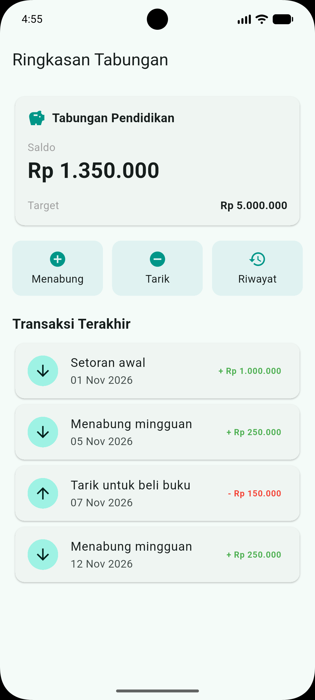
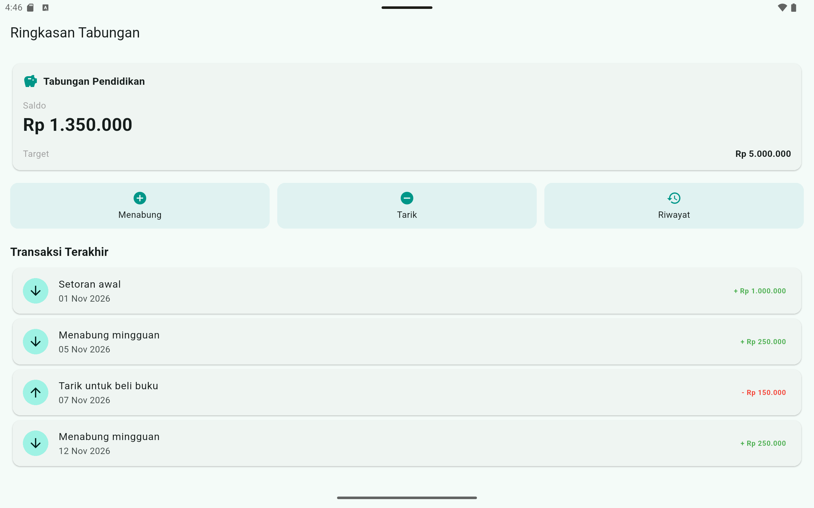

# TabungKu – Ringkasan Tabungan

Tugas Minggu 3: Menyusun Layout dengan Widget Dasar Flutter

- **Nama:** Luthfan Putra Prakarsa
- **NIM:** 20230801220

## Cara Menjalankan

1. Pastikan Flutter SDK sudah terpasang (`flutter doctor`).
2. Clone repositori ini, lalu masuk ke folder `pert3/tugas_GetX`.
3. Jalankan `flutter pub get`.
4. Jalankan `flutter run` pada emulator atau perangkat.
   Jika aplikasi tertahan di logo Flutter pada emulator, gunakan `flutter run --no-enable-impeller`.

## Tangkapan Layar

| Ponsel                     | Tablet |
|----------------------------|---|
|  |  |     